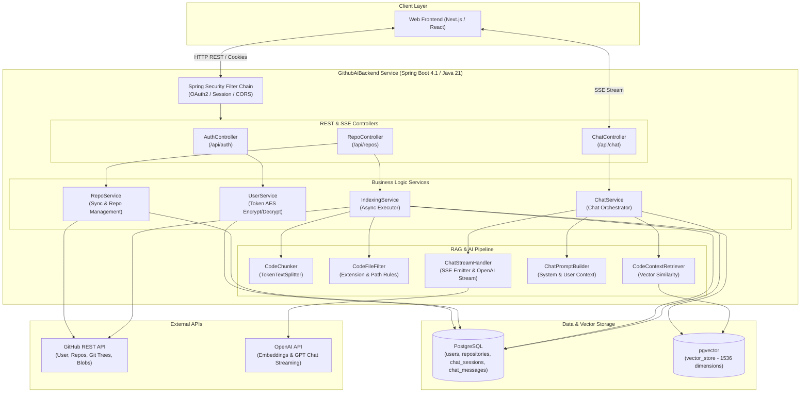
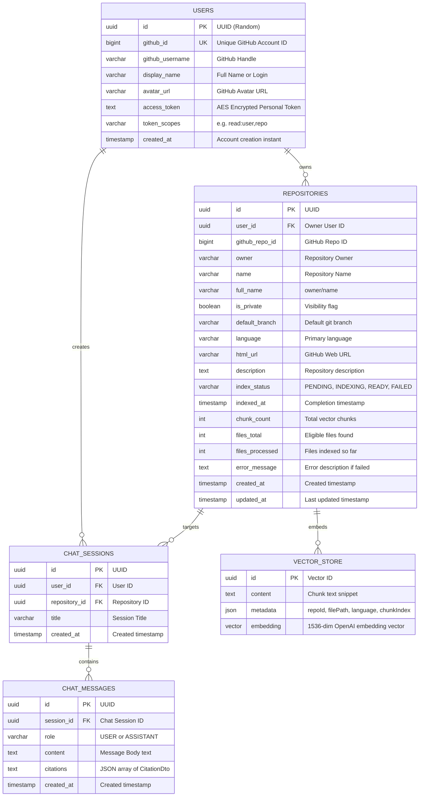
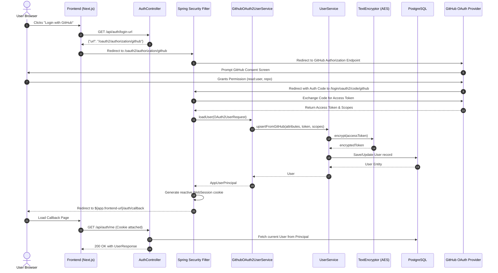
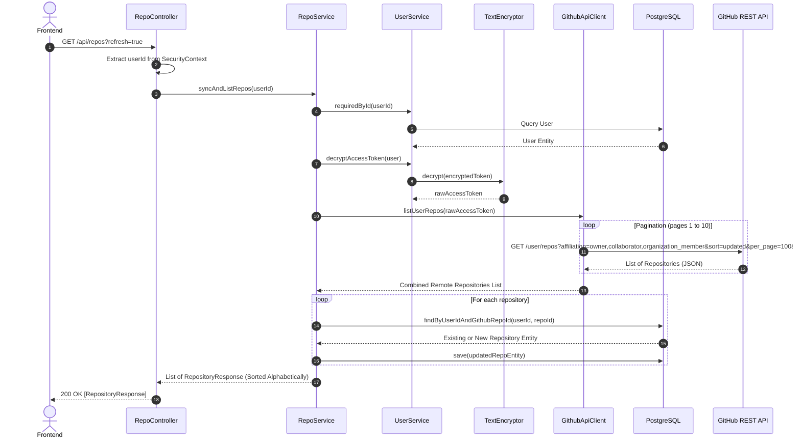
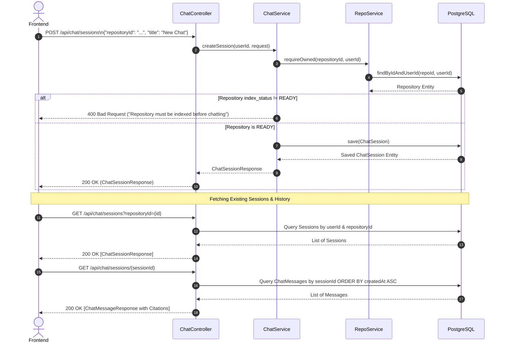
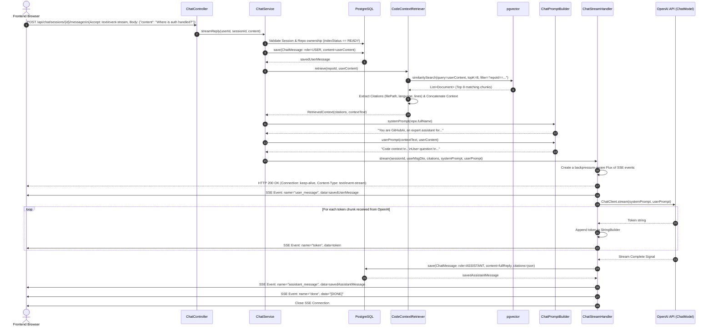
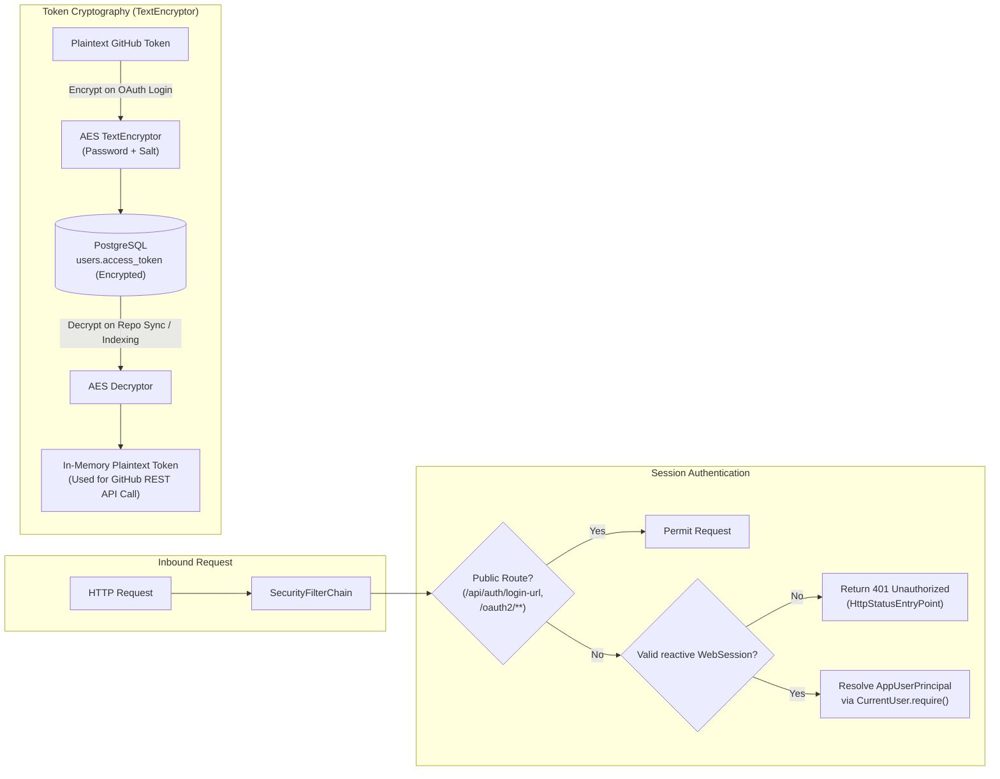
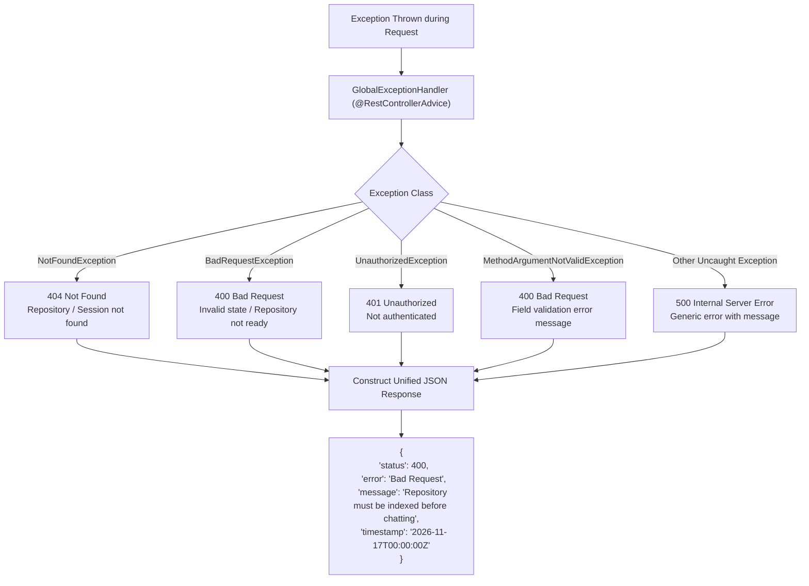

# GithubAiBackend - GitHub AI Assistant Service

> **High-Performance RAG (Retrieval-Augmented Generation) Microservice for GitHub Repositories**  
> Built with **Spring Boot 4.1.0**, **Java 21**, **Spring AI 2.0.0**, **PostgreSQL (pgvector)**, and **OpenAI**.

---

## Table of Contents

1. [Overview & Capabilities](#overview--capabilities)
2. [Architecture & System Overview](#architecture--system-overview)
3. [Technology Stack](#technology-stack)
4. [Data Model & Database Schema](#data-model--database-schema)
5. [End-to-End Architectural Flows](#end-to-end-architectural-flows)
   - [Flow 1: GitHub OAuth2 Authentication & Session Lifecycle](#flow-1-github-oauth2-authentication--session-lifecycle)
   - [Flow 2: Repository Synchronization & Discovery](#flow-2-repository-synchronization--discovery)
   - [Flow 3: Asynchronous Code Indexing & Embedding Pipeline](#flow-3-asynchronous-code-indexing--embedding-pipeline)
   - [Flow 4: Chat Session Management](#flow-4-chat-session-management)
   - [Flow 5: Semantic Retrieval & Real-Time SSE Streaming](#flow-5-semantic-retrieval--real-time-sse-streaming)
   - [Flow 6: Security & Token Encryption Architecture](#flow-6-security--token-encryption-architecture)
   - [Flow 7: Global Error Handling & Exception Management](#flow-7-global-error-handling--exception-management)
6. [API Reference & Specifications](#api-reference--specifications)
7. [Configuration & Environment Variables](#configuration--environment-variables)
8. [Local Development & Setup Guide](#local-development--setup-guide)
9. [Project Directory Structure](#project-directory-structure)

---

## Overview & Capabilities

**GithubAiBackend** is a reactive backend service that turns GitHub repositories into an interactive, context-aware AI assistant. Developers authenticate through GitHub, select a repository, index its code into a vector database, and chat with an LLM using server-sent events.

### Key Capabilities

- **Seamless GitHub OAuth2 Integration**: Secure GitHub login requesting `read:user,repo` scopes, with automated user synchronization.
- **At-Rest Token Encryption**: GitHub access tokens are symmetrically encrypted via AES before being written to PostgreSQL and decrypted in memory only when calling GitHub APIs.
- **Smart Code Filtering & Parsing**: Excludes lockfiles, binaries, vendor folders (`node_modules`, `target`, `dist`, `.git`), and large files (>100KB), while indexing 40+ programming languages and configuration formats.
- **Asynchronous Vector Indexing**: Reactor pipelines fetch and process repository files without blocking request threads, generating token-based chunks and storing 1536-dimensional embeddings in `pgvector`.
- **RAG-Powered Semantic Search**: High-precision vector similarity search fetching the top 8 most relevant code blocks per prompt.
- **Real-Time Token Streaming via SSE**: Server-Sent Events (`text/event-stream`) streaming partial tokens dynamically from OpenAI `gpt-4o-mini` with instant response delivery and final citation payload.

---

## Architecture & System Overview

The service operates as a Spring Boot application coordinating between three external ecosystems: **GitHub API**, **PostgreSQL + pgvector**, and **OpenAI**.



---

## Technology Stack

| Layer | Component | Description |
| :--- | :--- | :--- |
| **Language & Runtime** | Java 21 LTS | Utilizes modern Java records, virtual-thread readiness, and enhanced pattern matching |
| **Application Framework**| Spring Boot 4.1.0 + WebFlux | Reactive HTTP endpoints, security, and dependency injection |
| **AI Framework** | Spring AI 2.0.0 | High-level abstraction for OpenAI models and vector stores (`spring-ai-starter-model-openai`) |
| **Vector Store** | PostgreSQL + `pgvector` | Native relational database vector store with cosine/L2 distance search (`spring-ai-starter-vector-store-pgvector`) |
| **Database** | PostgreSQL, Spring Data R2DBC, and pgvector | Reactive relational persistence; vector-store JDBC calls are isolated on Reactor's bounded elastic scheduler |
| **Security & OAuth2** | Spring Security & OAuth2 Client | Reactive GitHub OAuth2 authorization flow, WebSession, and CORS filter |
| **Cryptography** | Spring Security Crypto | AES encryption via `TextEncryptor` for GitHub personal access tokens |
| **HTTP Client** | Spring `WebClient` | Non-blocking GitHub REST API requests |
| **Real-time Comms** | Reactor `Flux` + WebFlux SSE | Backpressure-aware Server-Sent Events streaming |
| **Boilerplate Reduction**| Project Lombok | `@Getter`, `@Setter`, `@Builder`, `@RequiredArgsConstructor`, and `@Slf4j` |

---

## Data Model & Database Schema

The relational database schema is structured around users, their GitHub repositories, chat sessions, and individual chat messages with vector references.



### Table Indices & Constraints

- **`users`**: Unique constraint on `github_id`.
- **`repositories`**: Unique composite constraint on `(user_id, github_repo_id)`.
- **`vector_store`**: Filtered search on metadata attribute `repoId`.

---

## End-to-End Architectural Flows

---

### Flow 1: GitHub OAuth2 Authentication & Session Lifecycle

The authentication mechanism uses Spring Security's OAuth2 client infrastructure. Once authorized by GitHub, the application intercepts the callback, extracts user attributes and access tokens, securely encrypts the token, stores the user in PostgreSQL, and issues an HTTP-only session cookie.



#### Logout Subflow:
- Client issues `POST /api/auth/logout`.
- Session is invalidated (`invalidateHttpSession(true)`).
- `SecurityContext` is purged.
- The reactive WebSession is invalidated.
- Responds with `204 No Content`.

---

### Flow 2: Repository Synchronization & Discovery

Users can fetch their GitHub repositories. The system queries GitHub, maps the response, and upserts the records into PostgreSQL for subsequent indexing and querying.



---

### Flow 3: Asynchronous Code Indexing & Embedding Pipeline

When a user initiates repository indexing, the reactive indexing pipeline is queued independently of the HTTP request, which returns `202 Accepted` immediately. GitHub calls and R2DBC persistence are non-blocking; synchronous pgvector operations are isolated on Reactor's bounded elastic scheduler.

```mermaid
flowchart TD
    Start(["Client: POST /api/repos/{id}/index"]) --> ValidateRepo["Validate Repository Ownership & Status"]
    ValidateRepo --> CheckStatus{"Is already INDEXING?"}
    CheckStatus -- Yes --> ThrowBadRequest["Throw BadRequestException (400)"]
    CheckStatus -- No --> SetIndexingState["Set status = INDEXING\nReset counts to 0\nSave to DB"]
    SetIndexingState --> ReturnAccepted["Return 202 Accepted with RepositoryResponse"]
    
    ReturnAccepted -.-> AsyncTrigger[["Reactive indexing pipeline"]]
    
    subgraph AsyncPipeline["Background Indexing Thread"]
        GetToken["Retrieve & Decrypt User GitHub Access Token"] --> DeleteVectors["Delete Previous Vectors\n(Filter: repoId == currentRepoId)"]
        DeleteVectors --> FetchTree["GitHub API: Fetch Full Git Tree\nGET /repos/{owner}/{repo}/git/trees/{branch}?recursive=1"]
        FetchTree --> FilterBlobs["Filter Blobs using CodeFileFilter\n(Exclude node_modules, target, lockfiles, >100KB)"]
        FilterBlobs --> UpdateInitialProgress["Update DB Progress: filesTotal = N, processed = 0"]
        
        UpdateInitialProgress --> LoopFiles{"For Each Eligible File"}
        
        LoopFiles -- Process File --> FetchFileContent["GitHub API: Fetch Blob Content\n(Decode Base64 if needed)"]
        FetchFileContent --> ChunkCode["CodeChunker: Split File via TokenTextSplitter\nPrepend // File: path\nAdd repoId, language, chunkIndex"]
        ChunkCode --> AppendBatch["Append Chunks to Batch Buffer"]
        
        AppendBatch --> BatchSizeCheck{"Batch Size >= 32?"}
        BatchSizeCheck -- Yes --> CallOpenAI["Call OpenAI Embeddings API & Store in pgvector"]
        CallOpenAI --> ClearBatch["Clear Batch Buffer"]
        BatchSizeCheck -- No --> CheckProgressCounter
        ClearBatch --> CheckProgressCounter{"Processed % 5 == 0?"}
        
        CheckProgressCounter -- Yes --> SaveDBProgress["Update DB: filesProcessed & chunkCount"]
        CheckProgressCounter -- No --> RateLimit
        SaveDBProgress --> RateLimit["GitHubRateLimiter: Pause 50ms"]
        RateLimit --> LoopFiles
        
        LoopFiles -- Finished All Files --> FlushRemaining{"Remaining Chunks in Batch?"}
        FlushRemaining -- Yes --> FlushVectors["Store Remaining Chunks in pgvector"]
        FlushRemaining -- No --> MarkReady
        FlushVectors --> MarkReady["Mark Repository READY\nSet indexedAt = now()\nSave to DB"]
    end

    AsyncPipeline -. Error Occurred .-> MarkFailed["Catch Exception:\nMark status = FAILED\nRecord error_message in DB"]

    PollStatus(["Client: GET /api/repos/{id}/status"]) -.-> ReadDB[("Read DB State")]
    ReadDB -.-> ReturnStatus(["Return IndexStatusResponse (progress / chunks / status)"])
```



#### Filtering Rules Implemented in `CodeFileFilter`:
- **Skipped Directories**: `node_modules`, `.git`, `dist`, `build`, `target`, `.next`, `vendor`, `__pycache__`, `.idea`, `.vscode`, `coverage`, `out`.
- **Skipped Lockfiles**: `package-lock.json`, `yarn.lock`, `pnpm-lock.yaml`, `composer.lock`, `cargo.lock`, `poetry.lock`.
- **Size Limit**: Files strictly exceeding `app.indexing.max-file-bytes` (default `102400` bytes = 100 KB) are omitted.
- **Allowed Extensions**: Whitelist of 40+ file formats (`.java`, `.ts`, `.tsx`, `.js`, `.py`, `.go`, `.rs`, `.rb`, `.cpp`, `.cs`, `.md`, `.yml`, `.json`, `.sql`, `Dockerfile`, `Makefile`, etc.).

---

### Flow 4: Chat Session Management

A chat session establishes an isolated conversational container linked to an indexed repository.



---

### Flow 5: Semantic Retrieval & Real-Time SSE Streaming

The core RAG query workflow combines pgvector similarity search, prompt augmentation, and Server-Sent Events (SSE) token streaming.



#### SSE Event Specifications:

| Event Name | Payload Format | Description |
| :--- | :--- | :--- |
| `user_message` | `ChatMessageResponse` (JSON) | Emitted immediately confirming user message receipt and persistence |
| `token` | `String` (JSON escaped string) | Real-time text token chunk generated by OpenAI |
| `assistant_message`| `ChatMessageResponse` (JSON) | Final message object with full content and array of `CitationDto` objects |
| `done` | `"[DONE]"` | End-of-stream delimiter signalling client completion |

---

### Flow 6: Security & Token Encryption Architecture

Security is built on defense-in-depth: stateless authentication tokens are avoided in favor of secure HTTP-only sessions, and sensitive third-party credentials (GitHub Personal Access Tokens) are encrypted before reaching persistent storage.



---

### Flow 7: Global Error Handling & Exception Management

Any domain or validation exception thrown across the service stack is captured by `GlobalExceptionHandler` and translated into a standard, structured JSON error response.



---

## API Reference & Specifications

### 1. Authentication Endpoints (`/api/auth`)

#### `GET /api/auth/login-url`
- **Description**: Returns the initial OAuth2 redirect path for GitHub authentication.
- **Authentication**: Public.
- **Response `200 OK`**:
  ```json
  {
    "url": "/oauth2/authorization/github"
  }
  ```

#### `GET /api/auth/me`
- **Description**: Retrieves the profile of the currently logged-in user.
- **Authentication**: Required (reactive WebSession cookie).
- **Response `200 OK`**:
  ```json
  {
    "id": "3fa85f64-5717-4562-b3fc-2c963f66afa6",
    "githubId": 12345678,
    "githubUsername": "octocat",
    "displayName": "The Octocat",
    "avatarUrl": "https://avatars.githubusercontent.com/u/583231"
  }
  ```

#### `POST /api/auth/logout`
- **Description**: Clears the session, invalidates authentication context, and clears cookies.
- **Authentication**: Required.
- **Response `204 No Content`**

---

### 2. Repository Endpoints (`/api/repos`)

#### `GET /api/repos`
- **Description**: Lists repositories accessible to the user.
- **Query Parameters**:
  - `refresh` (boolean, optional, default: `true`): If `true`, syncs the latest repository catalog from GitHub before returning. If `false`, returns stored repositories directly from the database.
- **Response `200 OK`**: Array of `RepositoryResponse`.

#### `GET /api/repos/{id}`
- **Description**: Gets details for a specific owned repository.
- **Response `200 OK`**:
  ```json
  {
    "id": "e9b207eb-bbdc-47cb-9d62-d3cf6e3d2319",
    "githubRepoId": 98765432,
    "owner": "octocat",
    "name": "Hello-World",
    "fullName": "octocat/Hello-World",
    "isPrivate": false,
    "defaultBranch": "main",
    "language": "Java",
    "htmlUrl": "https://github.com/octocat/Hello-World",
    "description": "My first repository",
    "indexStatus": "READY",
    "indexedAt": "2026-11-17T00:15:30Z",
    "chunkCount": 142,
    "filesTotal": 35,
    "filesProcessed": 35,
    "errorMessage": null
  }
  ```

#### `POST /api/repos/{id}/index`
- **Description**: Initiates background indexing for the repository.
- **Response `202 Accepted`**:
  Returns the repository object with `indexStatus: "INDEXING"`.

#### `GET /api/repos/{id}/status`
- **Description**: Polls indexing progress and status.
- **Response `200 OK`**:
  ```json
  {
    "repositoryId": "e9b207eb-bbdc-47cb-9d62-d3cf6e3d2319",
    "indexStatus": "INDEXING",
    "filesTotal": 120,
    "filesProcessed": 45,
    "chunkCount": 180,
    "indexedAt": null,
    "errorMessage": null
  }
  ```

---

### 3. Chat Endpoints (`/api/chat`)

#### `POST /api/chat/sessions`
- **Description**: Creates a new chat session for an indexed repository.
- **Request Body**:
  ```json
  {
    "repositoryId": "e9b207eb-bbdc-47cb-9d62-d3cf6e3d2319",
    "title": "Explaining the Security Architecture"
  }
  ```
- **Response `200 OK`**:
  ```json
  {
    "id": "a1b2c3d4-e5f6-7890-abcd-ef1234567890",
    "repositoryId": "e9b207eb-bbdc-47cb-9d62-d3cf6e3d2319",
    "title": "Explaining the Security Architecture",
    "createdAt": "2026-11-17T00:20:00Z"
  }
  ```

#### `GET /api/chat/sessions?repositoryId={id}`
- **Description**: Returns all chat sessions created for a repository, ordered by creation date descending.
- **Response `200 OK`**: Array of `ChatSessionResponse`.

#### `GET /api/chat/sessions/{id}`
- **Description**: Returns all historical messages for a chat session in chronological order.
- **Response `200 OK`**: Array of `ChatMessageResponse`:
  ```json
  [
    {
      "id": "f5e4d3c2-b1a0-9876-5432-10fedcba9876",
      "role": "USER",
      "content": "Where is the authentication filter configured?",
      "citations": [],
      "createdAt": "2026-11-17T00:21:00Z"
    },
    {
      "id": "01234567-89ab-cdef-0123-456789abcdef",
      "role": "ASSISTANT",
      "content": "The authentication filter chain is configured in `SecurityConfig.java`...",
      "citations": [
        {
          "filePath": "src/main/java/github/ai/backend/config/SecurityConfig.java",
          "startLine": null,
          "endLine": null,
          "language": "java"
        }
      ],
      "createdAt": "2026-11-17T00:21:05Z"
    }
  ]
  ```

#### `POST /api/chat/sessions/{id}/messages`
- **Description**: Streams LLM response over Server-Sent Events.
- **Headers**: `Accept: text/event-stream`, `Content-Type: application/json`
- **Request Body**:
  ```json
  {
    "content": "How does CodeFileFilter decide which files to ignore?"
  }
  ```
- **Stream Output**:
  ```text
  event: user_message
  data: {"id":"...","role":"USER","content":"How does CodeFileFilter decide...","citations":[],"createdAt":"..."}

  event: token
  data: "Code"

  event: token
  data: "File"

  event: token
  data: "Filter"

  event: assistant_message
  data: {"id":"...","role":"ASSISTANT","content":"CodeFileFilter uses...","citations":[{"filePath":"src/main/java/github/ai/backend/services/indexing/CodeFileFilter.java","language":"java"}],"createdAt":"..."}

  event: done
  data: [DONE]
  ```

---

## Configuration & Environment Variables

All settings are externally configurable via environment variables or `application.properties`:

| Property | Environment Variable | Default Value | Purpose |
| :--- | :--- | :--- | :--- |
| `server.port` | `SERVER_PORT` | `8080` | Port the backend server listens on |
| `spring.r2dbc.url` | `DATABASE_R2DBC_URL` | `r2dbc:postgresql://localhost:5433/githubai` | Reactive database connection |
| `spring.datasource.url` | `DATABASE_URL` | `jdbc:postgresql://localhost:5433/githubai` | JDBC connection used by Spring AI pgvector |
| `spring.datasource.username` | `DATABASE_USERNAME` | `postgres` | PostgreSQL username |
| `spring.datasource.password` | `DATABASE_PASSWORD` | `postgres` | PostgreSQL password |
| `spring.security.oauth2.client.registration.github.client-id` | `GITHUB_CLIENT_ID` | *(required)* | GitHub OAuth App Client ID |
| `spring.security.oauth2.client.registration.github.client-secret` | `GITHUB_CLIENT_SECRET` | *(required)* | GitHub OAuth App Client Secret |
| `spring.ai.openai.api-key` | `OPENAI_API_KEY` | *(required)* | OpenAI API secret key |
| `spring.ai.openai.chat.options.model` | `OPENAI_CHAT_MODEL` | `gpt-4o-mini` | Chat completion model |
| `spring.ai.openai.embedding.options.model` | `OPENAI_EMBEDDING_MODEL`| `text-embedding-3-small` | 1536-dimensional embedding model |
| `app.frontend-url` | `FRONTEND_URL` | `http://localhost:3000` | Redirect target for OAuth callbacks |
| `app.cors.allowed-origins` | `CORS_ALLOWED_ORIGINS` | `http://localhost:3000` | Allowed origins for cross-origin requests |
| `app.token-encryptor-password` | `TOKEN_ENCRYPTOR_PASSWORD` | *(required)* | Stable master password for token AES encryption; changing it invalidates stored encrypted tokens |
| `app.token-encryptor-salt` | `TOKEN_ENCRYPTOR_SALT` | `5c0744940b5c369b` | Hex-encoded salt for AES key derivation |
| `app.github.api-delay-ms` | `GITHUB_API_DELAY_MS` | `50` | Artificial delay between GitHub API calls (ms) |
| `app.indexing.chunk-size` | `INDEXING_CHUNK_SIZE` | `800` | Character size per code chunk |
| `app.indexing.max-file-bytes` | `INDEXING_MAX_FILE_BYTES` | `102400` (100 KB) | File size threshold for code indexing |

---

## Local Development & Setup Guide

### 1. Prerequisites
- **Java 21 JDK** or newer installed.
- **Maven 3.9+** (or use included `./mvnw`).
- **Docker & Docker Compose** (for PostgreSQL with `pgvector`).
- **GitHub Account** (to register an OAuth App).
- **OpenAI API Key** (with access to `gpt-4o-mini` and `text-embedding-3-small`).

### 2. Configure GitHub OAuth Application
1. Go to your GitHub account: **Settings** > **Developer settings** > **OAuth Apps** > **New OAuth App**.
2. Set:
   - **Application name**: `GithubAiLocal`
   - **Homepage URL**: `http://localhost:3000`
   - **Authorization callback URL**: `http://localhost:8080/login/oauth2/code/github`
3. Generate a new Client Secret and record both **Client ID** and **Client Secret**.

### 3. Launch PostgreSQL with pgvector
From the project root directory (`D:\devPilot`):
```bash
docker compose up -d
```
Verify the container is healthy:
```bash
docker ps
```
The database runs on port `5433` with user `postgres` and password `postgres`.

### 4. Export Required Environment Variables
In your terminal (PowerShell or Bash), configure both database drivers to point to the same PostgreSQL database:

**PowerShell (Windows)**:
```powershell
$env:OPENAI_API_KEY="sk-your-openai-key-here"
$env:GITHUB_CLIENT_ID="your_github_client_id"
$env:GITHUB_CLIENT_SECRET="your_github_client_secret"
$env:TOKEN_ENCRYPTOR_PASSWORD="a-long-random-secret"
$env:DATABASE_URL="jdbc:postgresql://localhost:5433/devpilot"
$env:DATABASE_R2DBC_URL="r2dbc:postgresql://localhost:5433/devpilot"
```

**Bash / macOS / Linux**:
```bash
export OPENAI_API_KEY="sk-your-openai-key-here"
export GITHUB_CLIENT_ID="your_github_client_id"
export GITHUB_CLIENT_SECRET="your_github_client_secret"
export TOKEN_ENCRYPTOR_PASSWORD="a-long-random-secret"
export DATABASE_URL="jdbc:postgresql://localhost:5433/devpilot"
export DATABASE_R2DBC_URL="r2dbc:postgresql://localhost:5433/devpilot"
```

### 5. Build and Run the Backend Service
Navigate to the `backend` folder:
```bash
cd backend
./mvnw clean spring-boot:run
```
The server will start at `http://localhost:8080`.

### 6. Verify Health
Open your browser and navigate to:
```text
http://localhost:8080/api/auth/login-url
```
You should see:
```json
{"url": "/oauth2/authorization/github"}
```

---

## Project Directory Structure

```text
backend/
├── pom.xml                               # Project dependencies & build plugins
├── mvnw / mvnw.cmd                       # Maven wrapper executables
└── src/
    ├── main/
    │   ├── java/github/ai/backend/
    │   │   ├── BackendApplication.java   # Spring Boot entry point
    │   │   ├── config/                   # Configuration beans
    │   │   │   ├── AppConfig.java        # WebClient builder
    │   │   │   ├── CorsConfig.java       # Cross-Origin Resource Sharing setup
    │   │   │   ├── CryptoConfig.java     # TextEncryptor AES token encryptor
    │   │   │   └── SecurityConfig.java   # Security filter chain & OAuth2 handlers
    │   │   ├── controllers/              # REST & SSE endpoints
    │   │   │   ├── AuthController.java   # /api/auth (me, login-url, logout)
    │   │   │   ├── ChatController.java   # /api/chat (sessions, stream messages)
    │   │   │   └── RepoController.java   # /api/repos (sync, get, index, status)
    │   │   ├── dto/                      # Data Transfer Objects
    │   │   │   ├── ChatMessageRequest.java
    │   │   │   ├── ChatMessageResponse.java
    │   │   │   ├── ChatSessionResponse.java
    │   │   │   ├── CitationDto.java
    │   │   │   ├── CreateChatSessionRequest.java
    │   │   │   ├── IndexStatusResponse.java
    │   │   │   ├── RepositoryResponse.java
    │   │   │   └── UserResponse.java
    │   │   ├── entity/                   # Spring Data Relational domain models
    │   │   │   ├── ChatMessage.java
    │   │   │   ├── ChatSession.java
    │   │   │   ├── IndexStatus.java
    │   │   │   ├── MessageRole.java
    │   │   │   ├── Repository.java
    │   │   │   └── User.java
    │   │   ├── exceptions/               # Global exception advice & errors
    │   │   │   ├── BadRequestException.java
    │   │   │   ├── GlobalExceptionHandler.java
    │   │   │   ├── NotFoundException.java
    │   │   │   └── UnauthorizedException.java
    │   │   ├── repository/               # Reactive Spring Data R2DBC repositories
    │   │   │   ├── ChatMessageRepository.java
    │   │   │   ├── ChatSessionRepository.java
    │   │   │   ├── RepositoryRepository.java
    │   │   │   └── UserRepository.java
    │   │   ├── security/                 # Security domain & Principal models
    │   │   │   ├── AppUserPrincipal.java
    │   │   │   ├── CurrentUser.java
    │   │   │   └── GithubOAuth2UserService.java
    │   │   └── services/                 # Business logic services
    │   │       ├── ChatService.java      # Chat pipeline orchestrator
    │   │       ├── RepoService.java      # Repo synchronization & status
    │   │       ├── UserService.java      # User upsert & token AES cipher
    │   │       ├── ai/                   # AI & Vector Retrieval
    │   │       │   ├── ChatPromptBuilder.java
    │   │       │   ├── ChatStreamHandler.java
    │   │       │   ├── CitationMapper.java
    │   │       │   ├── CodeContextRetriever.java
    │   │       │   ├── RagSettings.java
    │   │       │   └── RetrievedContext.java
    │   │       ├── github/               # GitHub API Client
    │   │       │   ├── GithubApiClient.java
    │   │       │   └── GitHubRateLimiter.java
    │   │       └── indexing/             # Code chunking & vector indexing
    │   │           ├── CodeChunker.java
    │   │           ├── CodeFileFilter.java
    │   │           └── IndexingService.java
    │   └── resources/
    │       ├── application.properties    # Central configuration file
    │       └── schema.sql                # Idempotent relational schema initialization
    └── test/
        └── java/github/ai/backend/
            └── BackendApplicationTests.java
```

---

## License

This project is licensed under the MIT License.
